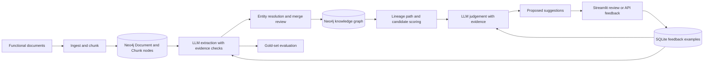

# DocGraph

DocGraph turns functional documentation into a provenance-aware knowledge graph and uses it to suggest data lineage links for human review.

> Project status: Phases 1–9 implemented and benchmarked on the 16-document gold set using `openai:nvidia/nemotron-3.5-lightning-30b-a3b` via an OpenAI-compatible endpoint (`OPENAI_BASE_URL`). Entity F1 is **0.648** (v1) / **0.613** (v2) and Relationship F1 improves from **0.520** (v1) to **0.594** (v2) across 15/16 evaluated documents (`DOC-OPS-016` was rejected by strict verbatim evidence validation).

## Quickstart

1. Copy `.env.example` to `.env` and change the local Neo4j password if needed.
2. Start Neo4j, the API, and review app with `docker compose up -d --build`.
3. Install the package on the host with `python -m pip install -e .` to use the CLI.
4. Ingest the synthetic corpus with `docgraph ingest data/raw`.
5. Set `LLM_PROVIDER`, `LLM_MODEL`, and the matching API key in `.env`, then run `docgraph extract`.
6. Open Neo4j Browser at <http://localhost:7474>, API docs at <http://localhost:8000/docs>, and the review app at <http://localhost:8501>.

## Architecture



Ingestion supports Markdown, plain text, PDF, and DOCX files. It normalizes whitespace, uses overlapping character chunks, and stores source hashes, full cleaned text, offsets, and chunk text in Neo4j. Re-ingesting a document replaces its chunk set within a transaction. The synthetic source corpus is documented in [data/raw/README.md](data/raw/README.md); the initial hand-labeled subset is in [data/gold/gold_v1.json](data/gold/gold_v1.json).

Extraction prompts are versioned under `prompts/extraction/`. Pydantic validates the response schema and every evidence quote must be an exact substring of the originating chunk. Validated responses are cached in SQLite at `.docgraph/extraction-cache.sqlite3`, written to timestamped JSONL files in `data/processed/`, and token usage is logged to `logs/extraction-usage.jsonl`. Cost estimates are omitted unless both optional per-million-token rates are configured.

See [docs/extraction.md](docs/extraction.md) for provider configuration, retry behavior, and a small-run command.

Entity resolution writes a resolved graph and a pending merge report for review. Run `docgraph resolve data/processed/extractions-<run>.jsonl`, inspect `data/processed/merge_report.json`, then load with `docgraph load data/processed/resolved_graph.json`. Resolution uses OpenAI embeddings by default; `--no-embeddings` enables lexical-only matching. Neo4j constraints and full-text/vector indexes are defined in [schema.cypher](src/docgraph/db/schema.cypher).

Run `docgraph suggest --limit 10` to inspect up to ten graph-derived lineage candidates with the configured LLM. Suggestions use multi-hop paths, shared neighbors, name/embedding similarity, and evidence-grounded LLM judgement. They are stored as `SUGGESTED_LINEAGE` with `status: proposed`; reviewers decide whether to accept or reject them. See [lineage.md](docs/lineage.md).

After running extraction over the full corpus, evaluate those real outputs with `docgraph evaluate data/processed`. The command writes CSV/JSON metrics and an F1 chart under `data/processed/evaluation/`. See [evaluation.md](docs/evaluation.md) for the matching rules and current baseline status.

Reviewer decisions and corrected extractions can be submitted with `docgraph feedback-lineage` and `docgraph feedback-extraction`; recent examples are included by extraction/lineage prompt v2. See [feedback.md](docs/feedback.md). The before/after comparison must be run after collecting actual v1 and v2 extraction outputs.

## Repository layout

```text
data/           Synthetic source documents and labels
docs/           Ontology, extraction, lineage, evaluation, and feedback guides
prompts/        Versioned extraction and lineage prompts
src/docgraph/   CLI, API, Streamlit app, and pipeline modules
tests/          Unit tests with mocked providers
.github/        GitHub Actions CI
```

## API

The FastAPI service exposes entity search, upstream/downstream dataset lineage, suggestion listing, and feedback submission. The Streamlit app uses the same query and feedback modules for an interactive review queue. See [docs/api.md](docs/api.md).

## Tests and CI

Install development tools with `python -m pip install -e ".[dev]"`, then run `pytest -q -m "not integration"`, `ruff check src tests`, and `mypy src/docgraph --ignore-missing-imports`. GitHub Actions runs these checks on each push and pull request and runs a separate graph-loader integration test against Neo4j 5.26. Unit tests use local fixtures and a mocked LLM; they do not require API credentials or Neo4j.

## Benchmark results (v1 vs. v2)

Measured on `data/gold/gold_v1.json` with `openai:nvidia/nemotron-3.5-lightning-30b-a3b` (`--no-embeddings` during resolution; 15/16 documents evaluated after verbatim evidence filtering):

| Run | Prompt | Evaluated Docs | Entity P / R / F1 | Relationship P / R / F1 |
| :--- | :---: | :---: | :---: | :---: |
| `full_v1` | `v1` | `15/16` | `0.522` / `0.854` / `0.648` | `0.444` / `0.627` / `0.520` |
| `full_v2` | `v2` | `15/16` | `0.483` / `0.841` / `0.613` | `0.471` / `0.804` / `0.594` |

- Prompt `v2` improved relationship recall from `0.627` to `0.804` and relationship F1 from `0.520` to `0.594` by explicitly prompting for ownership boundaries and negative/informal qualifiers.
- `DOC-OPS-016` failed verbatim substring evidence validation in both runs and was excluded from metric scoring rather than admitted as unverified fact.
- Running `docgraph suggest --prompt-version v2 --score-threshold 0.25` produced 5 proposed `SUGGESTED_LINEAGE` edges in Neo4j for human review.

## Known limitations

- The review UI is a small local tool; authentication and multi-user access control are not implemented.
- PDF ingestion extracts embedded text and does not perform OCR.
- Entity resolution defaults to 1536-dimensional OpenAI embeddings; `--no-embeddings` enables lexical-only matching without embedding API calls.
- The lineage suggestion path search is bounded and heuristic; suggestions still require a human decision.

## Query examples

The project includes more than 10 documented read-only Cypher examples in [docs/queries.md](docs/queries.md). Screenshots are not included yet because the graph and review UI have not been run with measured extraction results.

## Ontology

See [docs/ontology.md](docs/ontology.md) for node labels, relationships, provenance requirements, and design choices.
